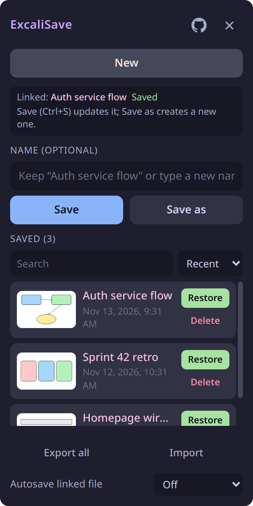

# ExcaliSave

[](https://github.com/callmegautam/ExcaliSave/actions/workflows/ci.yml)
[](https://github.com/callmegautam/ExcaliSave/releases/latest)
[](LICENSE)

Chrome extension for [excalidraw.com](https://excalidraw.com/): save named snapshots of your canvas, restore them later, and keep updating the same "file" as you draw. Images included. No server, no account.

<p align="center">
  
</p>

## Why

There are plenty of drawing tools, but Excalidraw is the one I keep coming back to. What kept pushing me toward other tools was saving: Excalidraw's own solution sits behind a paid plan. So I built this, for me first and for anyone in the same boat.

## Features

- Floating launcher on excalidraw.com that opens a small, draggable panel
- **New**, **Save** (update the linked file) and **Save as** (create a new one)
- Restore any save; theme, zoom, background and grid come back with it
- Pasted images are saved with the snapshot and restored correctly
- Warns before **New** or **Restore** would throw away unsaved changes
- **Undo** right after deleting a save
- **Export all** saves (images included) to one JSON file, **Import** them back on any machine
- Clear error messages when something goes wrong instead of failing silently

## Install

ExcaliSave is not on the Chrome Web Store yet, so it is installed unpacked.

### From a release (easiest)

1. Download `excalisave-vX.Y.Z.zip` from the [latest release](https://github.com/callmegautam/ExcaliSave/releases/latest) and unzip it.
2. Open `chrome://extensions`, turn on **Developer mode**.
3. Click **Load unpacked** and pick the unzipped folder.
4. Open [excalidraw.com](https://excalidraw.com/). The launcher sits in the top right corner.

### From source

```bash
git clone https://github.com/callmegautam/ExcaliSave.git
cd ExcaliSave
pnpm install
pnpm build
```

Then load the `dist` folder with **Load unpacked** as above.

### Updating

Replace the folder with the new version and click the reload icon on the ExcaliSave card in `chrome://extensions`. Your saves live in extension storage and are kept across updates.

## How it works

Excalidraw keeps the current scene in the page's `localStorage` and pasted images in IndexedDB. A save copies the scene, its app state (theme, zoom, grid) and every image it references into the extension's own storage (`chrome.storage.local` with the `unlimitedStorage` permission). Restore writes them back and reloads the page.

- **Nothing leaves your browser.** No server, no analytics, no network requests.
- Saves survive clearing excalidraw.com's site data, but are removed if you uninstall the extension. Use **Export all** for backups.
- Saves made with v0.0.1 (stored in excalidraw.com's `localStorage`) are moved to extension storage automatically the first time v0.1 runs. Images were never captured by v0.0.1, so those saves stay image-less.
- The "linked" file is tracked per browser profile on excalidraw.com, so **Save** always updates the file you last restored or created.

## Permissions

| Permission         | Why                                                                 |
| ------------------ | ------------------------------------------------------------------- |
| `storage`          | Keep your saves in extension storage instead of the site's storage  |
| `unlimitedStorage` | Drawings with images easily pass Chrome's default 10 MB quota       |
| `excalidraw.com`   | The panel only runs on excalidraw.com, nowhere else                 |

## Roadmap

- **v0.2:** search and sort, thumbnails, unsaved-changes marker, Ctrl+S to save, optional autosave
- **Later:** sync through your own Google Drive or a GitHub gist, folders or tags, version history per file, Firefox build

See the [changelog](CHANGELOG.md) for what shipped in each release.

## Development

```bash
pnpm install
pnpm dev       # Vite dev server with extension hot reload, load dist/ unpacked
pnpm build     # type check and production build into dist/
pnpm package   # build and zip dist/ into excalisave-v<version>.zip
```

Branches follow a simple git flow: `main` is always the latest release, `develop` collects the next one, and work happens on `feature/*` or `fix/*` branches. See [CONTRIBUTING.md](CONTRIBUTING.md).

## Author

**Gautam Suthar**, [iamgautamsuthar@outlook.com](mailto:iamgautamsuthar@outlook.com), [@callmegautam](https://github.com/callmegautam)

## License

[MIT](LICENSE)
